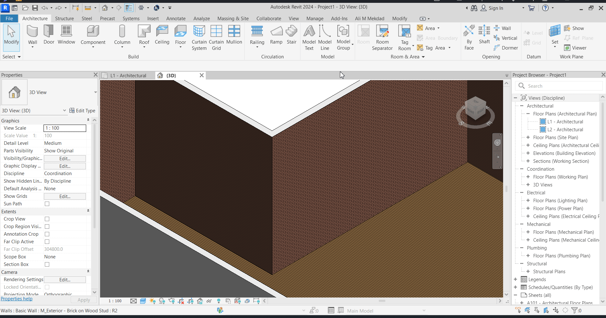
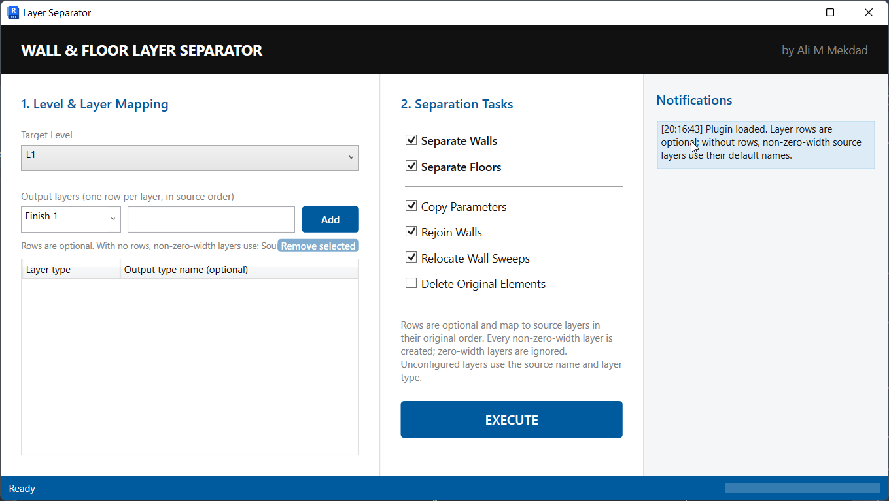
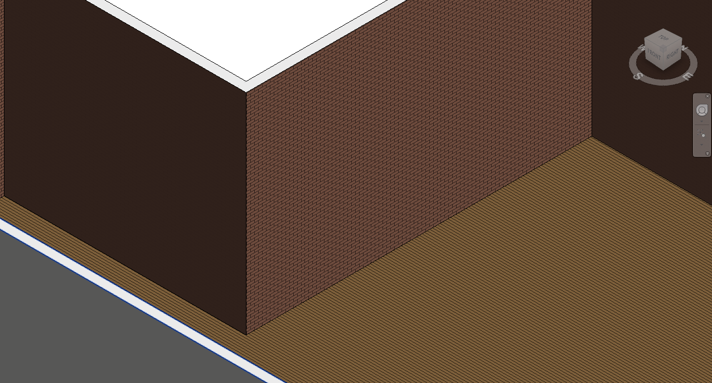
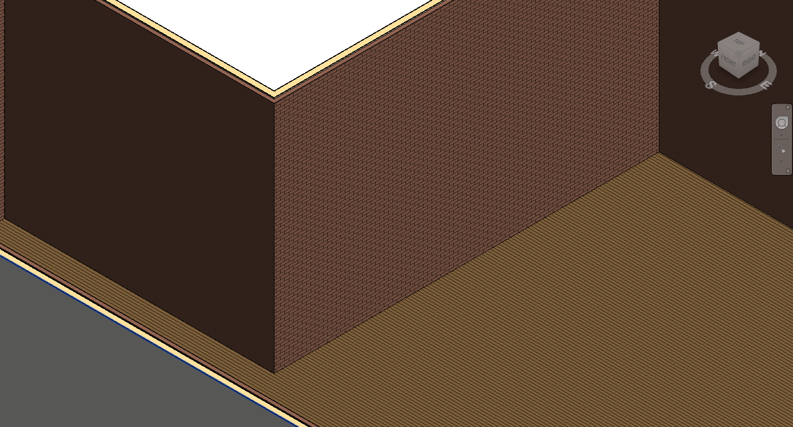
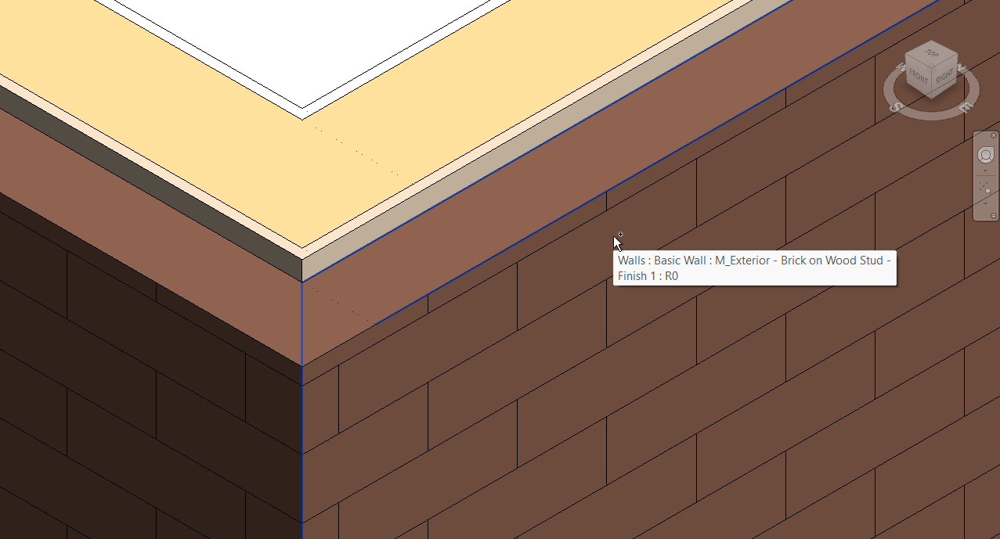
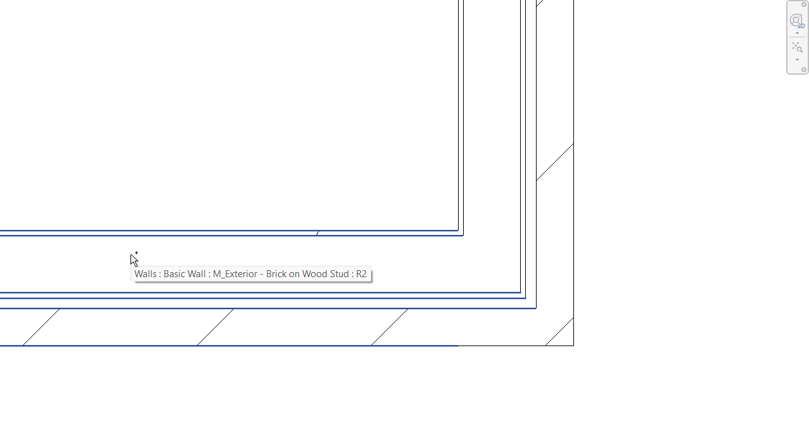
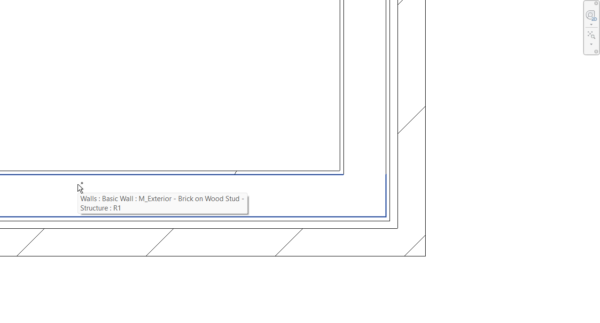
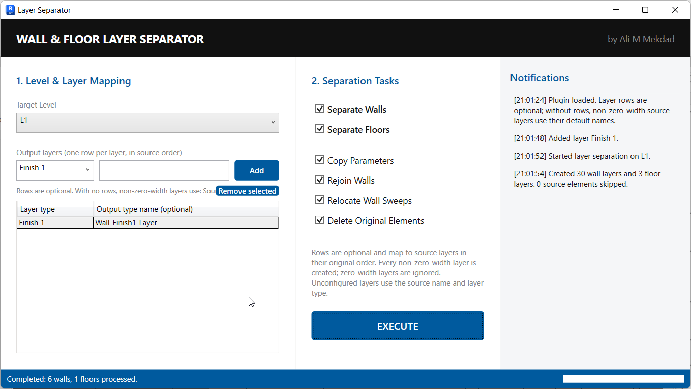

# Revit Wall & Floor Layer Separation

A C# Revit add-in that automates the separation of compound Walls and Floors into individual layer elements, supporting BIM workflows that require more detailed element modeling.

Designed primarily for **Autodesk Revit 2021**, the tool automates repetitive modeling operations, transfers applicable parameters, preserves the original layer geometry, and attempts to restore existing wall joins where applicable.

**Reported productivity improvement: approximately 75% time saved** across the Wall and Floor separation workflows.

---

## Table of Contents

- [Overview](#overview)
- [Key Features](#key-features)
- [How It Works](#how-it-works)
- [Demonstration](#demonstration)
- [Screenshots](#screenshots)
- [Technical Highlights](#technical-highlights)
- [Results and Impact](#results-and-impact)
- [Compatibility](#compatibility)
- [Source Code](#source-code)

## Overview

Compound Walls and Floors in Revit can contain multiple material layers within a single element. When a BIM workflow requires these layers to become individual elements, manually recreating them can involve substantial repetitive work.

This add-in automates the process by creating individual Revit elements corresponding to the original compound element's layers. The generated elements are positioned to preserve the original layer geometry, applicable parameters are transferred, and the original compound elements are removed when the corresponding operation is enabled.

The application provides a WPF interface for configuring the processing scope, layer naming, and supported separation operations.

## Key Features

- **Wall Layer Separation:** Separates existing compound Walls into individual layer elements.
- **Floor Layer Separation:** Applies the layer-separation workflow to existing compound Floors.
- **Level-Based Processing:** Filters elements by their associated Level, allowing users to limit processing scope and helping manage long-running operations on older hardware.
- **Configurable Layer Naming:** Allows users to define default names for layer types based on their type and position in the original compound structure. Mapping rows are optional.
- **Parameter Transfer:** Copies applicable parameters from original elements to newly created layer elements, excluding geometry-affecting parameters.
- **Geometry Preservation:** Positions generated elements to preserve the original layer geometry.
- **Conditional Wall-Join Restoration:** Attempts to restore joins between compatible layers when the original Walls were joined before separation.
- **Wall-Sweep Relocation:** Provides an option to relocate wall sweeps during the separation workflow.
- **Selectable Processing Operations:** Allows users to enable or disable supported operations, including parameter copying, wall rejoining, wall-sweep relocation, and deletion of original elements.
- **Execution Reporting:** Provides notifications and reports processing results to the user.

## How It Works

1. **Select a Level:** Choose the Level whose associated elements should be processed.
2. **Configure Layer Names:** Define default names for the layer types found in the original compound elements.
3. **Choose the Element Type:** Select whether to separate Walls or Floors.
4. **Configure Operations:** Enable or disable the supported processing operations according to the requirements.
5. **Execute Separation:** The add-in creates individual elements corresponding to the original compound element's layers.
6. **Transfer Parameters:** Copies applicable parameters, excluding parameters that affect geometry, when parameter copying is enabled.
7. **Restore Wall Joins:** Attempts to restore joins between compatible layers when the original Walls were joined and wall rejoining is enabled.
8. **Relocate Wall Sweeps:** Performs wall-sweep relocation when the operation is enabled.
9. **Remove Original Elements:** Removes the original compound elements when deletion is enabled.
10. **Review Results:** Displays execution notifications and processing results.

The exact operations performed depend on the options selected by the user.

## Demonstration

The following animated demonstration shows the add-in's workflow and the resulting model changes.

## Screenshots

### 1. Application Interface

The WPF interface provides Level selection, layer-name mapping, separation tasks, configurable operations, and notifications.

### 2. Wall Separation — 3D View

The following comparison shows two joined Walls before and after layer separation.

| Before Separation | After Separation |
|---|---|
|  |  |

### 3. Individual Wall Layers

A closer view of the resulting layer elements illustrates their relative positions after separation.

### 4. Wall Separation — Plan View

The plan-view comparison provides another perspective on the separation of the two joined Walls.

| Before Separation | After Separation |
|---|---|
|  |  |

### 5. Execution Results

The application provides feedback about the separation operation through its results and notification interface.

## Technical Highlights

- **Programming Language:** C#
- **BIM Platform:** Autodesk Revit
- **API:** Revit API
- **User Interface:** Windows Presentation Foundation (WPF)
- **Primary Target Version:** Autodesk Revit 2021
- **Element Processing:** Level-based filtering using the element's associated Level.
- **Parameter Management:** Transfer of applicable parameters to generated elements.
- **Geometry Handling:** Preservation of the original layer geometry.
- **Join Handling:** Conditional restoration of existing wall-join relationships.
- **Performance Considerations:** User-controlled processing scope to help manage execution time on older hardware.

## Results and Impact

The add-in was developed to reduce the repetitive manual work involved in separating compound Wall and Floor elements into individual layer elements.

**Reported productivity improvement: approximately 75% time saved** across the Wall and Floor separation workflows.

The reported improvement is an approximate, workflow-specific result rather than a universal performance benchmark.

## Compatibility

- **Primary target:** Autodesk Revit 2021.
- Compatibility with other Revit versions has not been established in this documentation.

## Source Code

The source code is not included in this public repository.

This repository serves as a portfolio case study showcasing the application's functionality, technical approach, and practical value in BIM automation.

## About This Project

This project demonstrates practical BIM automation using C# and the Revit API, with an emphasis on automating repetitive modeling tasks, managing element parameters, preserving layer geometry, and supporting more efficient BIM production workflows.
